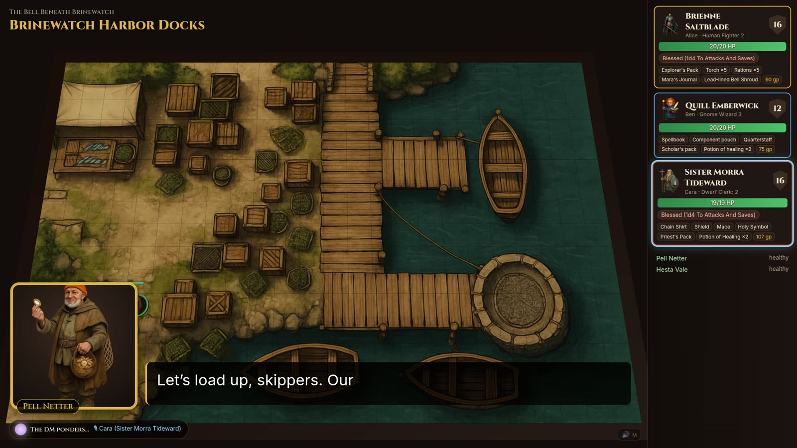
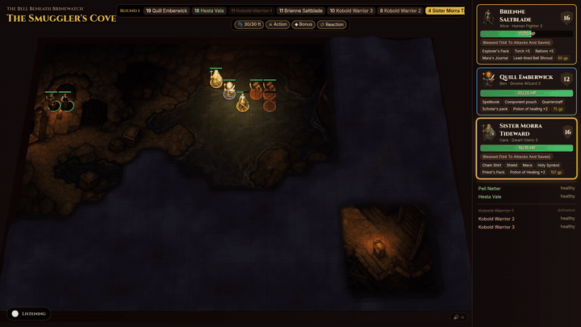
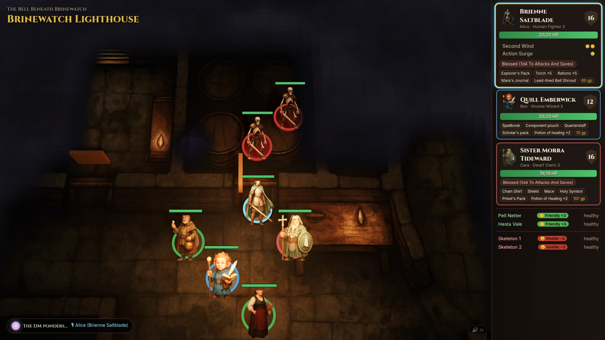
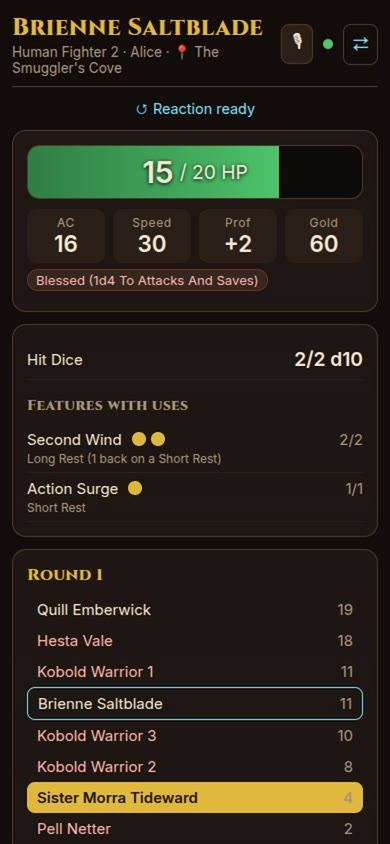
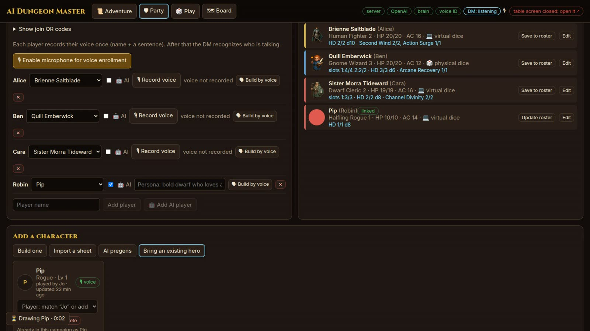
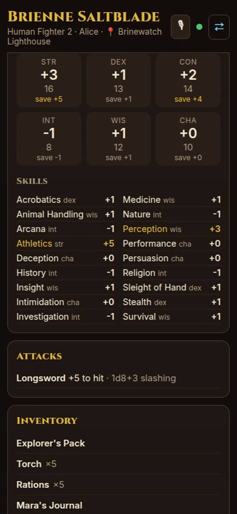
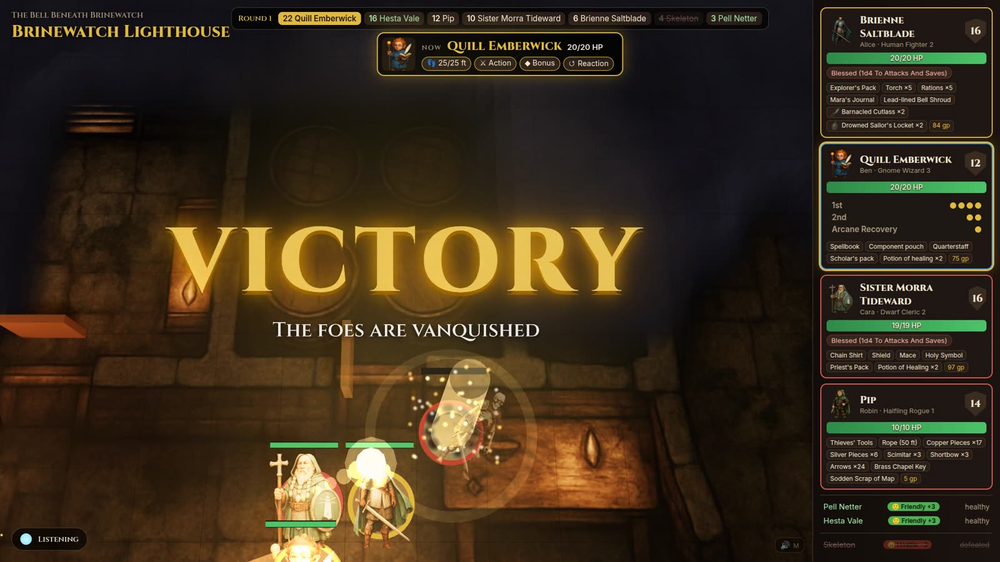
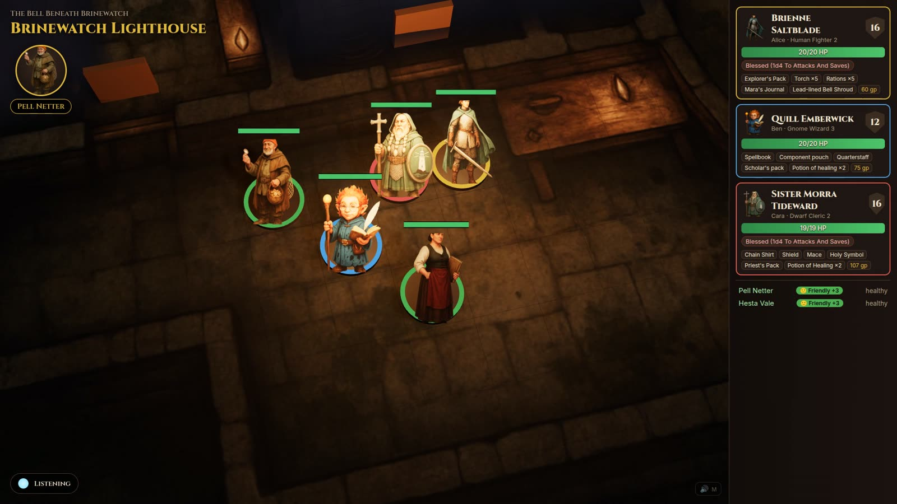

# Hearthmaster

**Hearthmaster is an AI voice Dungeon Master for in-person Dungeons & Dragons (5e 2024 / SRD 5.2).**
Sit around the table, talk to it like you would a human DM, and watch the adventure play out on your
TV: a painted 3D map, standee tokens, fog of war, physics dice and live party stats. Players follow
along on their phones, and friends who can't make it join online.



<!-- Demo video: drag marketing/demo-video/out/tour.mp4 (re-encoded under 10 MB) into this README in
     GitHub's web editor; GitHub turns it into a user-attachments URL that plays inline. Put it here. -->

## What it does

- 🗣 **Talks out loud.** The DM is a realtime voice model. Talk to it, interrupt it, ask it what the
  rules say. NPCs speak in their own voices, with a close-up portrait and subtitles on the TV.
- 🎙 **Knows who's talking.** Each player says their name once. After that, voiceprints tell
  players apart on one shared table mic (push-to-talk also says who's speaking).
- 📜 **Writes the adventure.** Give it a premise and it writes the acts, locations, NPCs and
  encounters, paints top-down battle maps and character and monster standees, and reads each map's
  walls, doors and features so movement and line of sight match the art.
- 🎲 **Rolls real 3D dice.** Physics dice on the TV always land on the server's result, and a natural 20
  bursts into a CRITICAL! card. Each character uses virtual dice or real ones (the player types the
  total on their phone).
- ⚔️ **Runs the rules.** The server does every mechanic through tools: attacks against AC,
  damage, conditions, spell slots, concentration, death saves, rests, levelling, and the turn economy
  (movement, action, bonus action, reaction). SRD 5.2.1 search plus your own house rules.
- 📱 **Puts a sheet in every pocket.** Phones show a live character sheet: HP, rolls, spells,
  inventory, notes and a map of where the character is.
- 💾 **Saves and resumes.** End a session and the DM opens the next one with a "previously on…"
  recap. Undo any change; export and import whole campaigns.

<p align="center">
  
</p>

## Screens

| Screen | URL | Who uses it |
|---|---|---|
| **Host** | `/host` | The laptop running the game: campaigns, party, characters, starting the DM, approvals, undo. It can be closed mid-game. |
| **Table** | `/table` | The TV. The 3D board, tokens, fog, dice, initiative and party cards. It also carries the voice call (mic and DM audio). |
| **Player** | `/player/:id` | Each player's phone on the home Wi-Fi: live sheet, rolls, physical-dice pad, spells, notes, character creation. |
| **Remote** | `/play/:id` | Players joining over the internet: the TV scene, a sheet drawer, push-to-talk, typed input, a transcript and video tiles. |

Table hotkeys: **F** fullscreen, **Q** join QR codes, **M** mute sounds, **P** mute the table mic,
**I** inventories, hold **Space** to talk.

<table>
  <tr>
    <td width="66%"></td>
    <td></td>
  </tr>
  <tr>
    <td></td>
    <td></td>
  </tr>
</table>

## Features

**At the table**
- **Moments** on the TV: battle intro, turn banners, victory, death and revival, NPC attitude
  changes, campaign end ([moments](docs/gameplay/moments.md)).
- **NPC attitude** from Hostile −5 to Friendly +5, moved by Influence checks and how the party
  treats them ([NPC attitude](docs/gameplay/npc-attitude.md)).
- **Loot and interactables**: items dropped on the map, plus chests, levers and altars to use
  ([loot](docs/gameplay/loot-and-interactables.md)). Doors open and close, and the fog lifts behind
  them.
- **Party split**: groups in different places, a focus button for the TV, and a frozen fight while
  another scene has the spotlight ([party split](docs/gameplay/party-split.md)).
- **AI players** fill empty seats. They speak on the TV in their own voice and play their
  character; the DM rolls for them ([AI players](docs/gameplay/ai-players.md)).

**Characters** ([creating characters](docs/gameplay/characters.md))
- Build in the host form, import a pasted sheet, generate pregens, or **build by voice** (the DM
  interviews the player).
- **On the phone**: a step-by-step builder or an AI chat helper, checked against the SRD 5.2 rules.
  A build that bends a rule goes to the host to approve or send back
  ([phone creation](docs/gameplay/phone-creation.md)).
- A **saved hero roster** shared by every campaign: bring a hero from last campaign into this one
  ([roster](docs/gameplay/character-roster.md)).

**Online play** ([online play](docs/setup/online-play.md))
- Share the game over a Cloudflare Tunnel. Remote players join with a table code
  (`WOLF-RUNE-7342`), the host signs in with a password.
- A peer-to-peer WebRTC call with webcams and character tiles
  ([online call](docs/web/online-call.md)).

<p align="center">
  
  
</p>

## Quick start

**You need:** Node.js 22+, pnpm 10 (`corepack enable`), a recent Chrome or Edge on the laptop and on
the TV, and an OpenAI API key. An Anthropic key is optional. Python 3.10+ is only for the docs
tooling.

```bash
pnpm install
cp .env.example .env               # add OPENAI_API_KEY (ANTHROPIC_API_KEY optional)
bash scripts/download-models.sh    # speaker-ID model (~26 MB) into ./models
pnpm build && pnpm start           # http://localhost:8787 and https://localhost:8443
```

- **Laptop:** open `http://localhost:8787/host`.
- **TV:** open `http://<laptop-ip>:8787/table`.
- **Phones:** press **Q** on the TV, or open **Show join QR codes** on the host's Party tab.

**No key yet?** `pnpm --filter @dm/server seed:demo && pnpm start` loads *The Sunken Chapel*: three
characters, three goblins and fog of war. Dice, tokens, combat and rules search work without AI.

More: [install and run](docs/setup/install-and-run.md) (including a desktop server with a laptop
table over HTTPS) and [configuration](docs/setup/configuration.md).

## Running a session

1. **Adventure tab:** create a campaign, set the party level, type a premise, and press **Write
   adventure**. The first map paints in the background.
2. **Party tab:** add players, press **🎙 Enable microphone for voice enrollment**, then **Record
   voice** for each player (about 5 seconds: "Hi, I'm Sam, and I'm playing Thorin…").
3. **Characters:** make or bring one for each player, any of the ways above. Set each to 💻
   virtual or 🎲 physical dice.
4. **Play tab:** open `/table` on the TV first, then press **🗣 Start voice DM** and allow the mic
   in the table tab.
5. **Play.** Hold to talk (push-to-talk is on by default), or whisper to the DM from the host.
6. **Finish:** Adventure tab → **End session & write recap**. Next time the campaign loads on its
   own and the DM opens with the recap. Voices are still known.

Full guide: [running a session](docs/gameplay/running-a-session.md).

**Cost.** Realtime voice is billed per audio minute: typically a few dollars per hour of play.
Stop the DM during breaks, use text-only mode for prep, and see
[cost notes](docs/gameplay/running-a-session.md#cost-notes) for image settings that save money.

## Configuration

Everything lives in `.env` (see [.env.example](.env.example) and the
[configuration reference](docs/setup/configuration.md)). The ones you're most likely to touch:

| Setting | What it does |
|---|---|
| `BRAIN_PROVIDER` | `openai` or `anthropic` for planning: outlines, pregens, sheet parsing, map reading, recaps, the phone creation chat |
| `AI_PLAYER_PROVIDER` | Which provider plays AI seats |
| `REALTIME_VOICE` | The DM's voice |
| `PUSH_TO_TALK` | `0` for an open table mic |
| `IMAGE_QUALITY`, `PREPAINT_MAPS` | Image detail versus cost; `PREPAINT_MAPS=0` paints maps only when needed |
| `SPEAKER_THRESHOLD` | How strict voice matching is |
| `HOST_PASSWORD`, `TABLE_CODE`, `ONLINE_URL` | Online play |

House rules: drop `.md`, `.txt` or `.pdf` files into `rules/custom/`. They outrank the SRD in rules
search.

## Known limits

- AI players can't answer a roll request themselves, and haven't been tested live with real
  speakers in a room yet.
- Phone creation doesn't cover Expertise, Weapon Mastery, Eldritch Invocations, a Wizard's full
  spellbook, or tool choices yet.
- Online call: remote players may hear the DM twice through room echo, the table's mute (**P**)
  doesn't mute the room for remote players, and call members can see each other's public IPs.
- One voice call lasts at most 60 minutes; the server renews it about every 50 without a break.

## For developers

```bash
pnpm dev          # server (tsx watch, :8787) + Vite (:5173)
pnpm test         # Vitest, all packages
pnpm typecheck    # tsc for shared, server and web
pnpm --filter @dm/server eval:voiceid   # voice-ID accuracy (needs download-models.sh --with-tts)
```

| Path | What's there |
|---|---|
| `packages/shared` | Zod schemas, DM tool definitions, events, dice notation |
| `apps/server` | Fastify + WebSocket server: game service, pure tool engine, realtime voice DM, speaker ID, brain, images, rules search, SQLite |
| `apps/web` | React + React Three Fiber: host, table, player and remote screens, 3D dice |
| `data/srd` | SRD 5.2.1 in Markdown |
| `rules/custom` | Your house rules |
| `docs/` | Documentation, grouped by area |

Start with the [documentation map](docs/README.md), the
[architecture overview](docs/architecture/overview.md) and the
[DM tool catalog](docs/reference/tool-catalog.md). Contributor rules (tests first, keeping docs
current) are in [CLAUDE.md](CLAUDE.md).

## License notes

`data/srd/` contains material from the System Reference Document 5.2.1 ("SRD 5.2.1") by Wizards of
the Coast LLC, available at https://www.dndbeyond.com/srd. The SRD 5.2.1 is licensed under the
Creative Commons Attribution 4.0 International License, available at
https://creativecommons.org/licenses/by/4.0/legalcode. The Markdown conversion is from
[downfallx/dnd-5e-srd-markdown](https://github.com/downfallx/dnd-5e-srd-markdown).
